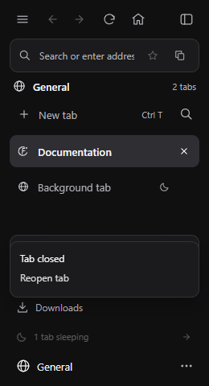
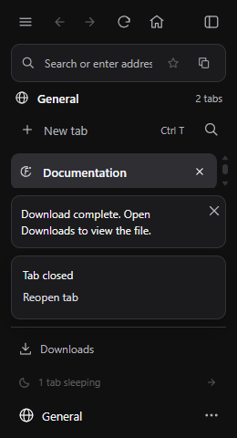
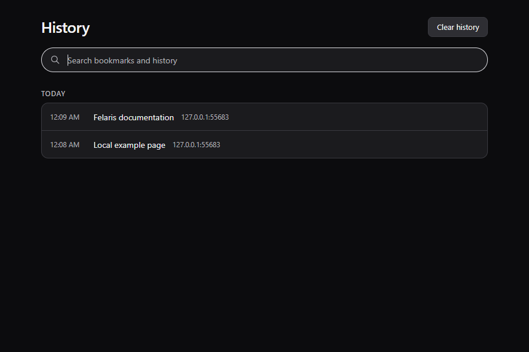
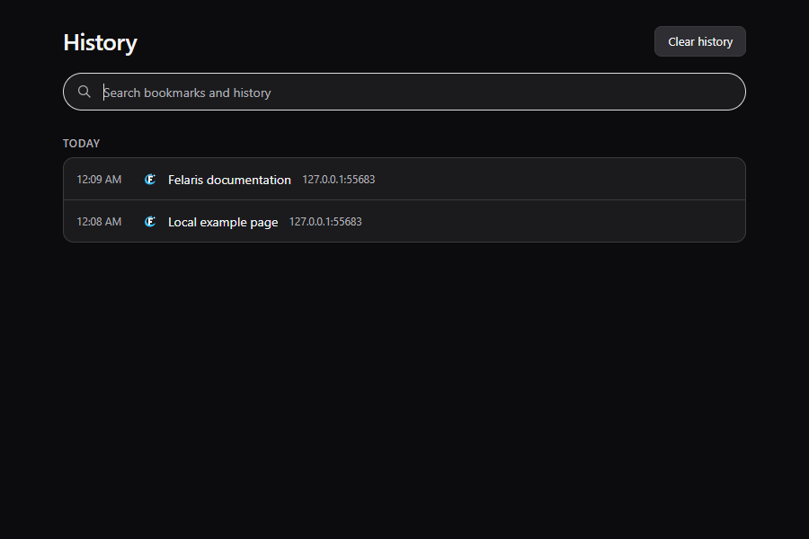
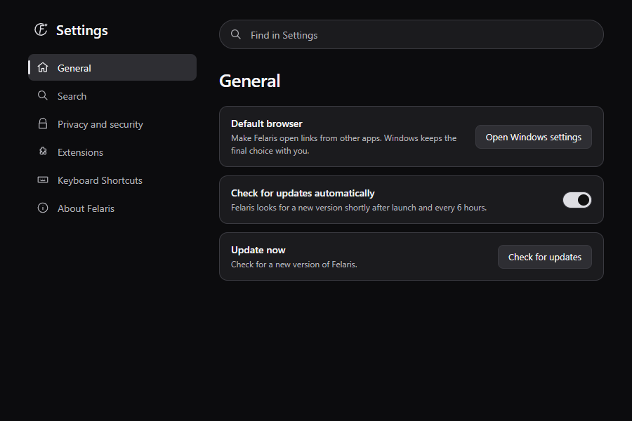
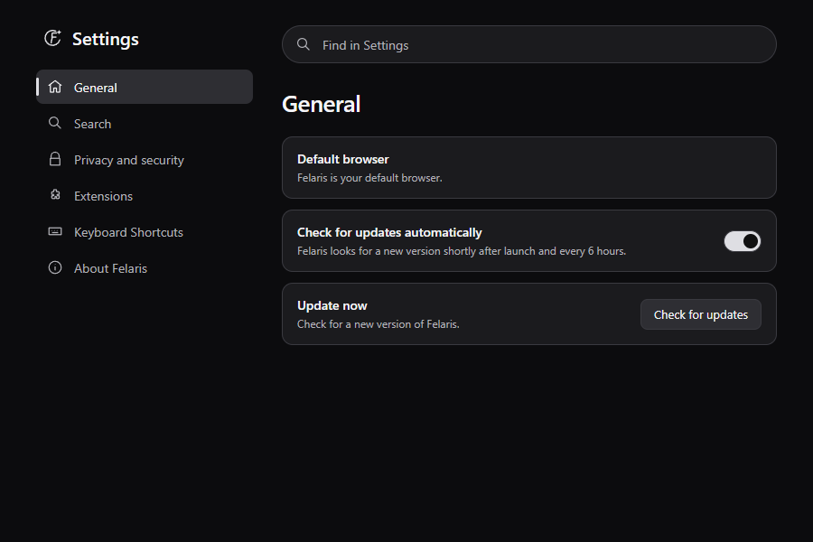

# Downloads and tab input evidence

The before images render application HTML from `473e30d`, the fetched `origin/main` base. The after images render this change. All images use synthetic local fixtures in an isolated Windows/WebView2 app owned by `tests/native_app.py`. They contain no user profile or browsing history. Sidebar captures are 260 by 480 pixels; history and Settings captures are 900 by 600 pixels.

| Change | Before | After |
| --- | --- | --- |
| Download status and tab-close undo |  |  |
| History icons |  |  |
| Already-default browser state |  |  |

The default-browser captures inject an already-selected state. They do not change Windows defaults. The native test reads the actual Windows association and checks both rendered states. The sleeping-icon tooltip is covered by a DOM assertion; an operating-system tooltip screenshot was not captured. These WebView PNGs show rendered content, not native composition or animation quality.

## Reproductions

- Before the child-view change, `python -B tests/tab_input.py` failed with `Sleeping tab leaked a native window: expected 5, got 6`. After the change it passes six sleep/wake cycles, checks native host counts, and clicks each woken page through the browser input driver. The exact long-idle session reported by the user was not available.
- The message-layout regression failed with `status and undo messages do not overlap` before the toast moved into normal layout. The same fixture now passes at desktop and minimum sizes.
- The download regression uses a real WebView2 download while deliberately omitting completion notifications. The file completes, its bytes match, and the active count clears. The user's original URL and the reason its completion notification was missed were not available.
- An initial download-test fixture treated a speculative Chromium connection as a real HTTP request. It now accepts connections until it receives a request. The corrected regression passed five consecutive runs.
- The first history-icon check exposed that `hidden` prevented lazy images from loading. The final code keeps images in layout with zero opacity until they load; the same native check now passes.

## Validation

Passed locally:

```text
cargo fmt --check
cargo clippy --all-targets --locked -- -D warnings
cargo test --locked                       # 34 tests
node tests/browser.test.cjs
python -B tests/release.test.py            # 17 tests
cargo build --locked
python -B tests/native_smoke.py
python -B tests/native_regressions.py      # includes tab_input.py and 68 UI assertions at two sizes
python -B tests/native_tools.test.py
```

See [native-results.json](native-results.json) and [capacity.json](capacity.json). The native regressions preserve pinned tabs, edited forms, media, and active downloads while bounding live WebViews at 12 in sessions with 100, 300, and 500 saved tabs. These are local fixture results, not performance guarantees. The application changes are identical across these runs; the final base update changed release workflow documentation and one preparation message, which the release tests also passed.

Local installer packaging and signing were not run. Windows PR CI covers package creation and temporary install/update/uninstall checks. This is a development PR; it does not bump the version or publish a release.

## Safety check

The shared native-lifetime change must not evict protected work or break other browser panels. This is proven at end-to-end level by `tests/tab_input.py` plus the full native suite: repeated sleep/wake leaves no native host behind, click dispatch works after waking, protected drafts/media/downloads remain alive, and popups, permission decisions, sidebar stacking, and session recovery pass.

The remaining risk is native focus, bounds, or stacking behavior on other Windows/WebView2 versions and arbitrary sites. Default detection requires both HTTP and HTTPS to resolve to `FelarisHTML`. History uses saved icons where available, then the site's favicon, then a globe. No profile migration or irreversible data change is involved.
