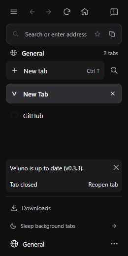
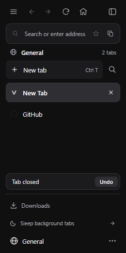
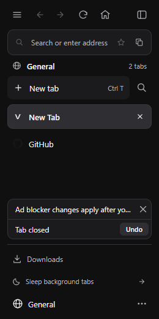
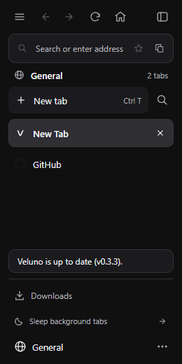

# Feedback toast evidence

Captures of `src/ui.html` at the 260px sidebar width in headless Chrome, using a synthetic two-tab fixture. `before.png` is `origin/main` after "Check for updates" followed by closing a tab. The `after-*` files show this branch: the undo row alone, a persistent message above the undo row, and the up-to-date result as a toast that expires.

