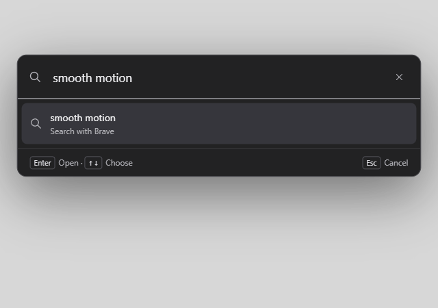
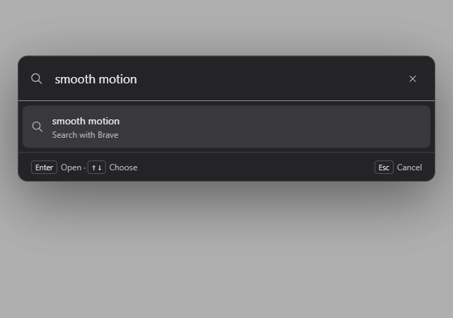

# Motion evidence

The two captures sample the native new-tab palette 60ms into its entrance, with the same synthetic Brave Search query. `before.png` runs the `origin/main` palette-opening function in the isolated test WebView; `after.png` runs this branch's function. Both use the current unchanged palette layout and colors. Captures were inspected. These WebView frames show the rendered intermediate state; they do not establish Windows composition or a frame-rate improvement.

Execution evidence:

- `cargo fmt --check`, `cargo clippy --all-targets --locked -- -D warnings`, and `cargo test --locked` passed, including 49 Rust tests.
- `node tests/browser.test.cjs` and `python -B tests/release.test.py` passed, including 18 release guards.
- `cargo build --locked`, `python -B tests/native_smoke.py`, `python -B tests/native_regressions.py`, and `python -B tests/native_tools.test.py` passed against the Windows/WebView2 app with isolated profiles.
- The DOM fixture passed 110 checks at 1380×860 and 108 at 640×480 with reduced motion. It checks interrupted palette reopening and cancellation of stale dismissal IPC.
- `python -B tests/topbar_animation.py` passed. Both native top-bar and popup loading preserve animation identity on duplicate updates, complete from the visible position, use transform keyframes, and finish hidden. The top-bar reduced-motion path stays static. Top-bar width stayed constant across 385 samples during sidebar reveal, hide, and reversal.
- The focused loading probe failed against the original build before the transform animation existed, then passed against the rebuilt app.
- The Impeccable detector reported two existing popup spacing warnings, with no motion findings. Popup geometry was preserved.

The first full-regression invocation exceeded its enclosing 60-second command limit after the UI and download checks. A subsequent uninterrupted run completed the whole suite, including 100/300/500-tab restoration, crash recovery, drafts, permissions, downloads, and cache recovery.

Local installer packaging was not run; the PR's Windows CI covers packaging and installer lifecycle checks. The no-comments pass found no redundant new comments. The full diff was reviewed directly because this session is Sol, so sol-loop was skipped.
