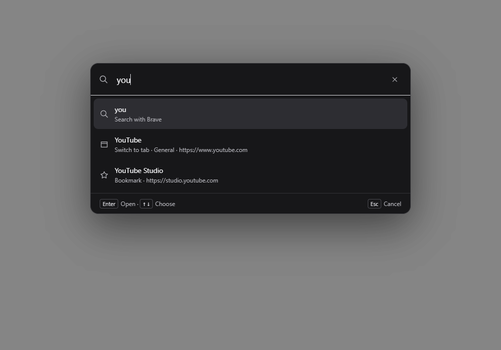
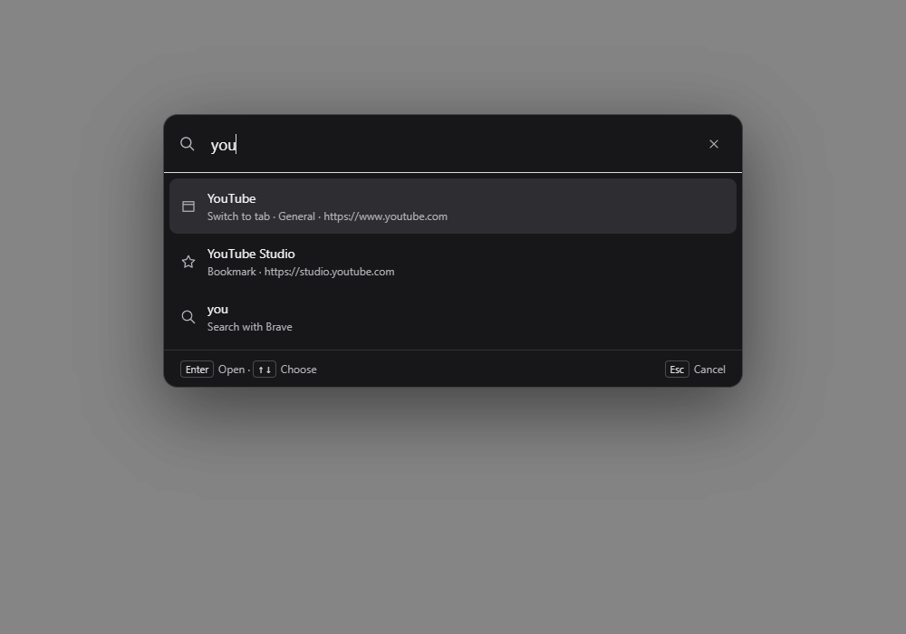

# Search ranking evidence

The palette used to select the web search row before matching local sites. It now selects strong host or title matches from open tabs, bookmarks, history, and shortcuts. Weak matches and ordinary queries keep web search first. Explicit addresses still open directly.

The captures use the same synthetic YouTube tab and YouTube Studio bookmark in the hidden Windows/WebView2 app. `before.png` runs the suggestion function from `origin/main`; `after.png` runs the changed function. Both use the input `you`. These captures prove WebView rendering and selection, not Windows composition or animation smoothness.

| Before | After |
| --- | --- |
|  |  |

The focused regression in `node tests/browser.test.cjs` failed before the fix with `An obvious open-tab match leads the search fallback`, then passed after it. The suite also checks weak matches, ordinary queries, explicit addresses, deduplication, the eight-result limit, and retaining the web search choice.

`tests/native_ui.mjs`, exercised in an isolated hidden app, types `you`, checks the selected YouTube fixture tab, presses Enter, and verifies the active tab changes. Its DOM fixtures cover Home, the sidebar, palette selection, arrow keys, IME composition, and delayed history updates at desktop and narrow viewport sizes.
