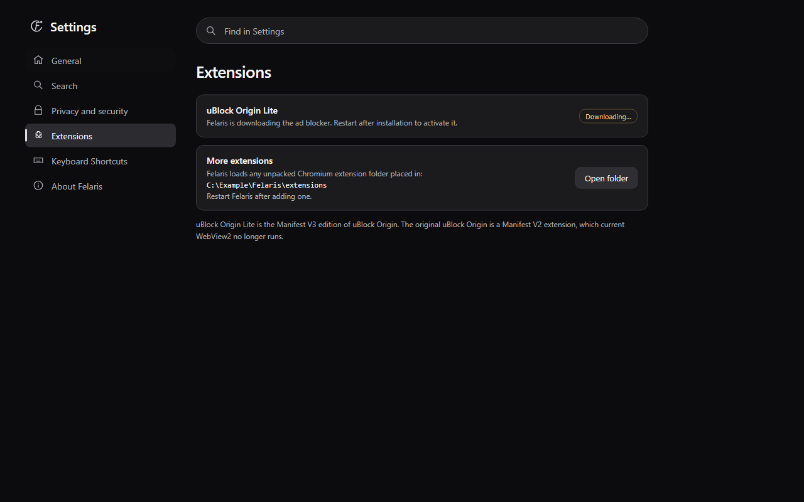

# Tab reliability evidence

The native regression run used the real Windows app and WebView2 with an isolated
profile and local HTTP fixtures. It passed with 100, 300, and 500 saved tabs.
Each session restored only its active WebView. After visiting 30 tabs, each run
settled at 12 actual WebViews and retained a pinned tab, an edited form, a media
page, and an active download. Waking a sleeping tab and recovery after a forced
exit also passed. See [capacity.json](capacity.json) and
[native-results.json](native-results.json).

The 500-tab run measured 1,110 ms to startup, a maximum tab-switch time of 176 ms,
and a process-tree working set of 1,577,349,120 bytes. These are single-machine
diagnostics with local fixtures, not guarantees for arbitrary websites or a
comparison with the baseline. A baseline capacity run was not captured.

Commands that passed locally:

```text
cargo fmt --check
cargo clippy --all-targets --locked -- -D warnings
cargo test --locked                         # 27 tests
node tests/browser.test.cjs                 # includes automatic sleep guards
python -B tests/release.test.py             # 15 tests
cargo build --locked
python -B tests/native_smoke.py
python -B tests/native_regressions.py        # capacity and 49 UI checks per size
```

The UI checks ran at 1380 x 860 and 640 x 480, with reduced motion at the smaller
size. Native smoke tests also checked page state after an ad blocker installation
completion event, link handoff, and recovery from a corrupt session file.

## Settings screenshots

Both screenshots render the actual Settings HTML at 1280 x 800 in the T3 browser.
The installation state and example profile path are mocked. No extension download
or real user profile was used for these screenshots. The baseline comes from
commit `c14839d3a38710677d56ef34b66af6e69d26d212`.

Before:


After:



## Safety limits

The live-tab budget is soft. Protected pages can exceed 12 live views. Custom
application state may escape edit detection, so users should pin pages that must
stay awake. Unloaded tabs lose their unsaved state and per-tab history. A forced
exit can lose changes since the last completed background save. Real camera and
microphone sessions and arbitrary commercial websites were not exercised.

Local installer packaging and signing were not run for this PR. The repository's
Windows CI packages and tests an installer without publishing a release.
