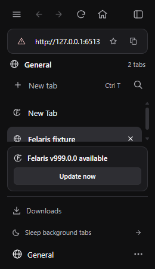
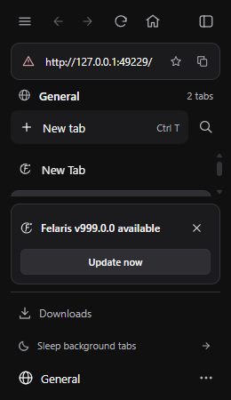
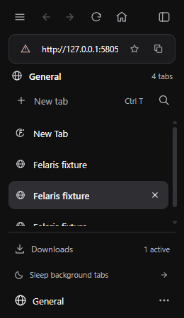
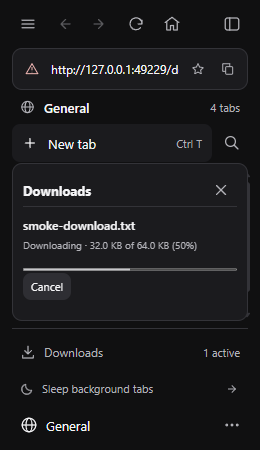
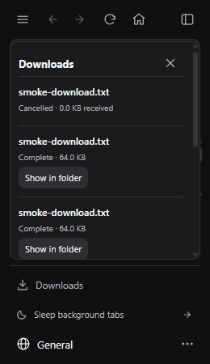

## Update notices and downloads

The update notice could not be dismissed. Downloads exposed only an active count, and opening their native dialog could target the hidden WebView retained after a download-only tab closed.

The notice now has a close button and saves the dismissed version in the session. Automatic checks keep that version hidden across restarts; a newer version or an explicit Check for updates can show a notice again. Downloads now opens a sidebar popover with filenames, received/total bytes, progress, completion/interruption status, Cancel for active transfers, and Show in folder for completed files. The popover opens when a download starts. Download entries describe the current app session.

Screenshots come from an isolated Windows/WebView2 fixture. The release version `999.0.0` is synthetic; the downloads are real HTTP transfers served locally. These WebView captures show rendered content, not Windows composition.

| Before | After |
| --- | --- |
|  |  |
|  |  |

`python -B tests/native_downloads.py` reproduced the missing dismissal button and missing download metadata on the original executable. On the fixed executable, the same checks pass and additionally verify partial byte progress, a completed 65,536-byte file, panel close/reopen, native cancellation with a zero active count, and update dismissal after a real app restart.

The native download checks also retain a source-page draft, remove download-only tabs without cancelling their transfers, and keep same-tab documents, redirects, and Home intact. 

An additional truncated-response probe observed interruption events but also left WebView2 retry operations pending. It is not a settled-network-failure test. The retained test uses native Cancel to prove terminal-state delivery and active-count cleanup deterministically.
